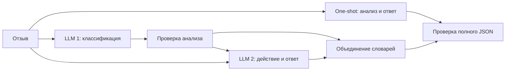

# Анализ отзывов интернет-магазина

Домашнее задание № 1. Проектирование и реализация базового LLM-workflow.
Курс «Автоматизация работы с большими генеративными моделями».

## Назначение системы

Система помогает оператору поддержки обработать текстовый отзыв: определить тональность и главную проблему, выбрать действие и составить черновик ответа клиенту. Реализованы One-shot и Sequential через OpenRouter. Ответы не отправляются клиентам автоматически.

Вход — русскоязычный текст до 20 000 символов. Пустой отзыв допустим как случай, требующий уточнения. Две самостоятельные операции LLM: анализ содержания и подготовка действия с ответом.

Результат:

```json
{
  "sentiment": "negative",
  "issue": "delivery",
  "needs_clarification": false,
  "action": "investigate",
  "reply": "Сожалеем о задержке. Уточните номер заказа для проверки доставки."
}
```

Поля `sentiment`, `issue` и `action` принимают одно строковое значение из заданного перечня. `needs_clarification` — boolean, `reply` — непустая строка до 1200 символов. Лишние поля, пропуски и неверные типы отклоняются.

- Тональность: positive, negative, mixed, neutral.
- Главная проблема: delivery, quality, payment, service, none, other.
- Действие: thank, clarify, investigate, escalate.

При нескольких проблемах выбирается первая упомянутая. При недостатке информации запрашивается уточнение, при явном риске безопасности требуется эскалация. Полные правила находятся в `POLICY` файла `app.py` и одинаковы для обеих архитектур.

## Архитектура



One-shot решает обе операции одним логическим LLM-вызовом. В Sequential первый вызов возвращает тональность, категорию и необходимость уточнения. Второй получает исходный отзыв и проверенный словарь анализа, выбирает действие и составляет ответ. Итоговые словари объединяются в Python. Для сравнения используется одна модель.

Sequential выбран из-за зависимости ответа от анализа проблемы. Промежуточный результат доступен для проверки и может использоваться в следующих этапах проекта. Риск подхода — распространение ошибочной классификации на второй этап и дополнительная точка отказа. Parallel не отражает эту зависимость, а Routing при одной предметной области пока не требуется.

## Запуск

Нужен Python 3.10+; сторонние библиотеки не используются. Все команды выполняются из каталога проекта.

```bash
python3 -m unittest discover -s tests -v
```

API-ключ передаётся через переменную окружения `OPENROUTER_API_KEY`. Для zsh на macOS:

```bash
read -s "OPENROUTER_API_KEY?OpenRouter API key: "
export OPENROUTER_API_KEY
printf '\n'
python3 app.py --model 'liquid/lfm-3-1.7b:free' --repeats 1 --interval 3.2 --interval-from start --retries 0 --max-tokens 4096 --out results/reproduction
unset OPENROUTER_API_KEY
```

Это воспроизводит настройки первичного эксперимента. Один полный прогон на 14 примерах требует максимум 42 HTTP-запроса без повторов. Бесплатные модели ограничены по частоте и доступности; их текущие лимиты нужно проверять у OpenRouter. Ключ не сохраняется в проекте.

`--interval-from start` задаёт интервал между началами запросов; `end` — паузу после окончания предыдущего запроса. Для более осторожного режима используйте `--interval 5 --interval-from end`. По умолчанию допускаются два повтора временных сетевых ошибок; в измеренном прогоне они отключены. `--out` задаёт отдельный каталог, чтобы не перезаписать готовые результаты.

Программа сохраняет `runs.json`, `summary.json` и генерирует `REPORT.md`. В сдаваемый комплект включены исходные записи и сводные метрики; итоговый анализ приведён ниже.

`recover.py` повторяет только неуспешные входы из `results/live`, сохраняя прежние попытки в `previous_attempt`. При установленном ключе команда запуска — `python3 recover.py`. Повторное выполнение перезаписывает `results/recovered`; перед воспроизведением сохраните исходные результаты отдельно.

## Методика тестирования

Набор `data/test_cases.json` содержит 14 синтетических отзывов с эталонами, заданными до эксперимента. Включены обычные жалобы и похвала, смешанная тональность, сарказм, пустой текст, неопределённая оценка, нейтральный факт, риск безопасности, prompt injection, отрицание и несколько проблем. Эталоны не передаются модели. Неоднозначные случаи оцениваются по принятой политике.

Обе архитектуры получают одинаковые входы; порядок перемешивается с seed=42. Temperature=0 снижает вариативность, но не гарантирует детерминизм. Измеряются:

- Доля полных валидных результатов среди всех запусков.
- Качество: средняя доля совпадений четырёх полей `sentiment`, `issue`, `needs_clarification`, `action`. Неуспех получает 0; отдельно приводится оценка только успешных результатов.
- Среднее время wall-clock, включая предусмотренные паузы и ожидание.
- Среднее число HTTP-попыток, включая неуспешные.
- Токены и стоимость из `usage` провайдера. При отсутствии данных среднее по всем входам неизвестно, а не равно нулю.

Свободный ответ не входит в автоматическую метрику качества: его содержательные ошибки разбираются по примерам. JSON-валидность не означает правильность смысла. Для дальнейшей оценки текста предлагаются три критерия: соответствие фактам, полезность действия и ясность формулировок; нужна независимая человеческая разметка.

## Обработка ошибок и проверки

Проверяются JSON, полный набор полей, допустимые категории, тип boolean и непустой ответ. Обрабатываются таймауты, сетевые сбои, HTTP-ошибки и обрезанные ответы. HTTP 429 и временные 5xx допускают ограниченные повторы с backoff; постоянные ошибки не повторяются. Исправление JSON дополнительным вызовом не выполняется, чтобы сохранить One-shot.

При отказе первого этапа Sequential второй не запускается. При отказе второго частичный анализ не считается полным успешным результатом. Ключ и заголовки авторизации в журнал не записываются.

14 тестов unittest проверяют количество вызовов baseline, передачу анализа, сбои обоих этапов, схему, ограничение входа, оценку неуспеха, HTTP 429/401, учёт usage, отсутствие usage, конфигурацию бесплатной модели, набор данных и генерацию отчёта. Все тесты пройдены. Подставные ответы в тестах проверяют код, а не качество LLM.

## Результаты эксперимента

Эксперимент проведён 8 ноября 2026 года через OpenRouter на бесплатной модели `liquid/lfm-3-1.7b:free`. Python 3.13.3; temperature=0; max_tokens=4096. Использованы 14 заранее размеченных примеров и один повтор. Цены входных и выходных токенов выбранной модели равны нулю. Платные модели и платный fallback не использовались.

## Основной прогон

Это основной результат сравнения: одинаковые входы, фиксированная модель, порядок архитектур перемешан с seed=42. Исходные записи: `results/live/runs.json`. HTTP 429 считаются неуспехом; они не удалены из выборки.

| Метрика | One-shot | Sequential |
|---|---:|---:|
|Число входов|14.000|14.000|
|Доля успешных выполнений|0.786|0.357|
|Качество четырёх полей на всех входах|0.661|0.268|
|Качество полей только при успехе|0.841|0.750|
|Среднее время, с|8.351|8.047|
|Среднее число HTTP-вызовов|1.000|1.571|
|Средние токены по всем входам|н/д|н/д|
|Средняя стоимость по usage, USD|н/д|н/д|

Качество = доля совпадений четырёх полей с эталоном; полный неуспех оценивается нулём. Это не метрика качества свободного ответа. Среднее время включает паузы rate limiting и backoff, поэтому отражает режим этого эксперимента, а не чистую скорость инференса. Низкое время неуспешного workflow не означает ускорения: обработка часто обрывается на первом этапе.

Токены и стоимость по всем входам неизвестны: HTTP-ошибки не содержат usage. Нельзя заменять отсутствие usage нулём. Для успешных первичных результатов получены следующие реальные средние:

| Показатель на успешных результатах | One-shot | Sequential |
|---|---:|---:|
|Токены|2078.091|4102.800|
|Стоимость USD|0.000|0.000|

Эти средние посчитаны на разных подвыборках успешных входов и не доказывают причинный эффект архитектуры на расход. Денежная цена тарифа — $0; при этом расход токенов и задержка остаются ресурсными затратами.

## Повтор после временных отказов

Для исходных неуспехов выполнена одна дополнительная попытка с паузой 5 секунд после завершения запроса. Успешные первичные ответы не перегенерировались. В results/recovered/runs.json сохранены previous_attempt и новая попытка. Это восстановление после сбоев, а не независимая повторная выборка. Его показатели нельзя смешивать с первичной оценкой надёжности.

| Показатель последней попытки каждого входа | One-shot | Sequential |
|---|---:|---:|
|Доля полных результатов|0.929|0.714|
|Качество четырёх полей, все входы|0.786|0.625|
|Качество полей, успешные|0.846|0.875|
|Средние HTTP-вызовы|1.000|1.857|
|Среднее время, с|11.452|18.113|

one_shot: всего HTTP-попыток с учётом восстановления — 17; подтверждённые токены — 27648. Это нижняя граница общего расхода, так как usage некоторых ошибок отсутствует.

sequential: всего HTTP-попыток с учётом восстановления — 38; подтверждённые токены — 44705. Это нижняя граница общего расхода, так как usage некоторых ошибок отсутствует.

## Разбор расхождений

**№07 — сарказм.** «Прекрасная доставка: всего-то месяц ожидания вместо двух дней!» Эталон negative/delivery/false/investigate. One-shot выбрал mixed, Sequential — negative. Оценка полей выросла с 0.75 до 1.0: раздельный анализ в этом случае помог распознать сарказм. Однако workflow написал «мы уже изучили причину задержки», что не следует из отзыва. Исправление метки не устранило галлюцинацию в ответе.

**№09 — неопределённая оценка.** «Ну такое, сами понимаете». One-shot вернул neutral/none/true/clarify (0.75: эталон issue=other). Sequential вернул positive/none/false/thank (0.0) и поблагодарил за якобы понравившиеся товары. Ошибка первого этапа передалась второму: декомпозиция не гарантирует правильного анализа и может усилить ошибку.

**№11 — безопасность.** В исходном отзыве зарядка задымилась и появился запах гари. Sequential выбрал investigate вместо escalate, а ответ переописал неисправность как неполный заряд и обещал контакт «в ближайшие дни». Нужны правила проверки опасных ситуаций и запрет неподтверждённых действий, а не только проверка JSON.

## Обработка ошибок и дополнительное исследование

Промпт задаёт допустимые значения категорий как enum строки. Это устраняет неоднозначность между списком вариантов и массивом в результате. Обработчик сохраняет код ошибки и серверное пояснение, исключая API-ключ из записей.

В новых запусках HTTP 429 сопровождается сообщением провайдера о временном ограничении общего бесплатного пула. Увеличение паузы помогло части запросов, но не гарантирует доступность. Обработчик не возвращает частичный JSON за успешный результат. Искусственные тесты отказа первого и второго этапа подтверждают соответственно остановку до второго вызова и неуспех после уже выполненного анализа. Второй паттерн workflow не реализован; дополнительное исследование отказов выполнено.

## Итоговый выбор и ограничения

Переход к Sequential не дал общего улучшения в этом эксперименте: отдельный выигрыш на сарказме сочетается с ошибками на неопределённом отзыве и дополнительными точками отказа. Для следующего этапа выбирается One-shot как базовая рабочая архитектура; Sequential сохраняется для развития проверяемого промежуточного анализа. На бесплатном тарифе денежная стоимость обоих подходов равна нулю, но два этапа требуют дополнительных токенов и могут дольше ждать провайдера.

Набор мал, синтетический и размечен одним автором. Один повтор, нестабильная доступность ограничивают выводы. Не заявляется статистическая значимость. Следующие шаги: независимый набор реальных обезличенных отзывов, человеческая разметка несколькими оценщиками, несколько полных повторов, строгие Structured Outputs и отдельная проверка семантических противоречий. Для безопасности и бизнес-обещаний нужны проверенные правила и внешние инструменты; для полезных ответов — RAG по политике магазина.

## Структура проекта

- `app.py` — OpenRouter-клиент, обе архитектуры, оценка и отчёт.
- `recover.py` — воспроизведение дополнительной попытки после сбоев.
- `data/test_cases.json` — входы и эталоны.
- `tests/test_app.py` — автономные проверки.
- `results/live/` — первичный эксперимент.
- `results/recovered/` — дополнительная попытка с историей.

Описание API: [OpenRouter Chat Completions](https://openrouter.ai/docs/api/reference/overview). Модель: [LiquidAI LFM3-1.7B free](https://openrouter.ai/liquid/lfm-3-1.7b:free).
